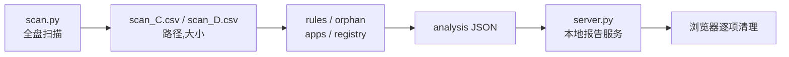

<h1 align="center">storage-analyzer</h1>

<p align="center">
  <b>简体中文</b> | <a href="./README_EN.md">English</a>
  <br><br>
  <a href="https://github.com/ChenChen913/storage-analyzer/actions/workflows/tests.yml"></a>
  <a href="LICENSE"></a>
</p>

给 AI Agent 用的全盘存储分析 Skill：扫描 → 三灯分级 → 网页一键删除（含永久删除）。

当前版本 0.3.1 ｜ 43 项测试 ｜ 零第三方依赖

## 目录

- [为什么做这个项目](#为什么做这个项目)
- [快速开始](#快速开始)
- [用法](#用法)
- [配置](#配置)
- [项目结构](#项目结构)
- [开发](#开发)
- [常见问题](#常见问题)
- [已知限制](#已知限制)
- [如何贡献](#如何贡献)
- [许可证](#许可证)

## 为什么做这个项目

已经有很多工具能回答「哪个目录最大」。这个 Skill 想回答的是下一个问题：**这些占地方的东西，哪些能删、怎么删、删了会怎样。**

它是给 Agent 用的，不是又一个 GUI 分析器。整个流程写在 `SKILL.md` 里，Agent 读完之后自己决定怎么扫、怎么分级、怎么处置；11 个 Python 脚本是它调用的工具，不需要你手动敲。

作者做这件事的直接动机：想要一个能被 Agent 直接调用、跨轮记住结论的清理工具。

**与同类方案的主要差异是跨轮记忆。** 第 1 轮把每个 ≥20MB 目录的定性写进 `state/registry.json`，第 2 轮从 `registry.py diff` 的增量清单开始，而不是每次从零重看一遍。没有这一层，同一条路径会在每一轮被当成「新发现」重复分析。

## 快速开始

前置要求：

- Python 3，仅用标准库，无需 `pip install`
- Windows 为主（macOS 分支保留上游实现，本仓库未复验；Linux 不支持）
- 可选：Everything 的 `es.exe` 或 WizTree 的 `WizTree64.exe`，装了扫描会快很多

仓库不含安装脚本。把整个目录放进宿主 Agent 的 skills 路径即可，本机实测位置是 `~/.agents/skills/storage-analyzer`。

三步跑完一次分析：

```sh
# 1. 全盘扫描，产出 JSON 与每盘一份 CSV
python scripts/scan.py --out "%TEMP%\storage_scan.json"

# 2. 增量审计（多盘要把 CSV 全传）
python scripts/rules.py  --csv "%TEMP%\scan_C.csv" "%TEMP%\scan_D.csv" --out "%TEMP%\rules_hits.json"
python scripts/orphan.py --csv "%TEMP%\scan_C.csv" "%TEMP%\scan_D.csv" --min-mb 50 --out "%TEMP%\orphans.json"
python scripts/apps.py   build --csv "%TEMP%\scan_C.csv" "%TEMP%\scan_D.csv"
python scripts/registry.py diff --csv "%TEMP%\scan_C.csv" "%TEMP%\scan_D.csv"

# 3. 写 analysis JSON 后起报告服务
python scripts/server.py "%TEMP%\storage_analysis.json"
```

第 3 步的 `storage_analysis.json` 要自己写，结构见 `scripts/build_report.py` 顶部注释。

## 用法



**数据源自动降级**：Everything → WizTree → `os.scandir` 全盘遍历。三者导出的都是同一份「路径,大小」CSV，后续聚合完全一致。`--source` 可以强制指定其中一个。

**扫描可信度**写在输出的 `coverage` 字段里：`complete` / `partial` / `limited` / `suspect`。`suspect=true` 表示文件数为 0 但磁盘已用，这种结果不能用来做清理决策。

**三灯分级**：

| 灯 | 含义 | 网页上能做什么 |
|---|---|---|
| 🟢 可自动清理 | 纯缓存、临时文件、安装包残留，可再生 | 移到回收站 / 直接删除 |
| 🟡 需人工判断 | 含用户数据或有判断成本 | 移到回收站 / 打开目录 |
| 🔴 谨慎清理 | 想动但不建议手删，应走正规卸载 | 打开目录 |

报告服务启动后的实际输出（数字随扫描结果变化）：

```text
$ python scripts/server.py "%TEMP%\storage_analysis.json"
报告服务已启动：http://127.0.0.1:30228/
绿灯可删 40 项 | 黄灯可移回收站/打开文件夹 15 项 | 页面上点
永久删除：已启用（默认）。不可恢复，请逐项确认；只想要可逆模式就加 --no-allow-rm。
允许的根目录：<user profile> | C:\Program Files | C:\Program Files (x86)
```

服务绑定 `127.0.0.1`，端口随机，每次启动生成随机 token。关掉服务，网页上的按钮立即失效。

## 配置

环境变量：

| 名称 | 必填 | 默认值 | 说明 |
|---|---|---|---|
| `STORAGE_ANALYZER_STATE` | 否 | `<repo>/state` | 覆盖状态目录（`registry.json`、`audit.jsonl` 存放处） |
| `STORAGE_ANALYZER_WIZTREE` | 否 | 自动探测 | 指定 WizTree 可执行文件路径，便携版用 |
| `TEMP` / `TMP` | 否 | 系统临时目录 | 扫描中间 CSV 的落盘位置 |

`scan.py` 主要参数：

| 参数 | 默认值 | 说明 |
|---|---|---|
| `--drives` | 全部固定盘 | 逗号分隔，如 `C,D` |
| `--source` | `auto` | `auto` / `everything` / `wiztree` / `walk` |
| `--wiztree-admin` | 关 | 走提权路径导出，覆盖受保护目录 |
| `--reuse-csv` | 关 | 复用已有 CSV，跳过导出阶段 |
| `--min-dir` | `10` | 目录聚合的最小 MB 阈值 |
| `--top` | `80` | 各组输出条目数上限 |
| `--out` | 空 | 写 JSON 到文件；不填则输出到 stdout |

`server.py` 主要参数：

| 参数 | 默认值 | 说明 |
|---|---|---|
| `--allow-rm` | 开 | 兼容旧命令用，行为等同默认 |
| `--no-allow-rm` | — | 关闭永久删除，只提供移到回收站 |
| `--allow-root PATH` | 仅 `%USERPROFILE%` 与两个 `Program Files` | 额外放行的根目录，可重复 |
| `--port` | `0` | 监听端口，0 表示随机 |
| `--no-browser` | 关 | 启动后不自动打开浏览器 |

`--out` 建议始终使用。PowerShell 的 `>` 会写出带 BOM 的 UTF-8，后续 `json.load` 会直接报错。

## 项目结构

```text
storage-analyzer/
├── SKILL.md              # Skill 入口：流程、规则、渐进式披露索引
├── scripts/
│   ├── scan.py           # 全盘扫描，数据源降级，产出 JSON + CSV
│   ├── rules.py          # 规则引擎：成组命中清理候选
│   ├── orphan.py         # 卸载残留：数据目录在、应用本体不在
│   ├── apps.py           # 应用登记表与「未审查清单」
│   ├── registry.py       # 跨轮档案：baseline / diff / mark / stats
│   ├── drilldown.py      # 单目录下钻
│   ├── build_report.py   # 把 analysis JSON 注入模板，生成静态报告
│   ├── server.py         # 本地报告服务 + 删除 API
│   ├── history.py        # 报告里的「新发现 / 删后复发」标注
│   ├── statefile.py      # 状态文件原子写与跨进程锁
│   └── report_util.py    # 模板注入前的转义
├── references/           # 16 篇按场景拆分的参考文档
├── assets/
│   └── report_template.html
├── tests/
│   └── test_storage_analyzer.py
└── state/                # 运行时状态，已在 .gitignore 中忽略
```

## 开发

```sh
# 语法检查（CI 里跑的那条）
python -m py_compile scripts/*.py

# 单元测试：43 项，其中 2 项真实回收站用例默认跳过
python -m unittest discover -s tests -v
```

CI 在 `.github/workflows/tests.yml`：Ubuntu + Windows 矩阵，Python 3.11，只跑上面两条命令。

真实回收站用例要设 `SA_REAL_RECYCLE=1` 才会执行，跑完会在你的回收站里留下测试项。

## 常见问题

**扫出来的文件数是 0，但磁盘明明装满了？**
`scan.py` 会比对「文件数为 0」与「磁盘已用」，矛盾时标 `coverage.suspect=true`、`partial=true`。常见原因是数据源工具没启动或权限不足，按 `fallback_reasons` 排查后重扫，不要基于这种结果做清理决策。

**没装 Everything 也没装 WizTree 会怎样？**
自动回退到 `os.scandir` 全盘遍历。能用，但百万文件级别要几十分钟。装了任一索引工具，单盘通常十几秒。

**报告页上某些项没有「移到回收站」按钮？**
该项没有 `trash_paths`，或者路径不在允许根目录内。跨盘路径要启动时加 `--allow-root "D:\"`。

**用 PowerShell 生成 JSON 后读取报 `Unexpected UTF-8 BOM`？**
`>` 会写带 BOM 的 UTF-8。改用各脚本的 `--out` 参数，它们直接写无 BOM 的 UTF-8。

## 已知限制

- **Linux 不支持**：`scan.py` 遇到 Linux 直接返回 `unsupported_platform`。
- **macOS 未复验**：保留了上游实现与废纸篓删除逻辑，但本仓库没有实际验证过。
- **非管理员权限有盲区**：WizTree 普通权限读不到 `WindowsApps` 等受保护目录，此时 `coverage.limited=true`；卷影副本 `System Volume Information` 始终读不到，总量会有差额。
- **网页删除默认只覆盖 `%USERPROFILE%` 与 `Program Files`**：动其他盘要显式 `--allow-root`。
- **0.3.1 起没有敏感目录黑名单**：家目录根、`AppData`、`System32` 只要在报告白名单内就会被真的删掉，且没有回收站兜底。这是有意为之的设计选择，不是缺陷。
- **不提供「一键全自动清盘」**：每一步清理都需要明确的路径清单。

## 如何贡献

问题与建议提到 [Issues](https://github.com/ChenChen913/storage-analyzer/issues)，欢迎 PR。

如果是新增清理规则，请把规则加进 `scripts/rules.py` 的 `RULES`，并补一条测试——规则引擎是成套清理的兜底，手工按文件名挑文件会漏。

## 许可证

[MIT](LICENSE) © 2026 数字生命卡兹克

本仓库改造自 [KKKKhazix/khazix-skills](https://github.com/KKKKhazix/khazix-skills) 的 `storage-analyzer`，仅发布并改造这一个 skill，归属与改造范围见 [NOTICE](NOTICE)。
