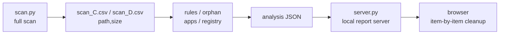

<h1 align="center">storage-analyzer</h1>

<p align="center">
  <a href="./README.md">简体中文</a> | <b>English</b>
  <br><br>
  <a href="https://github.com/ChenChen913/storage-analyzer/actions/workflows/tests.yml"></a>
  <a href="LICENSE"></a>
</p>

A disk-wide storage analysis Skill for AI agents: scan → three-tier grading → one-click deletion in the browser (permanent deletion included).

Version 0.3.1 ｜ 43 tests ｜ zero third-party dependencies

## Table of contents

- [Why this project](#why-this-project)
- [Quick start](#quick-start)
- [Usage](#usage)
- [Configuration](#configuration)
- [Project structure](#project-structure)
- [Development](#development)
- [FAQ](#faq)
- [Known limitations](#known-limitations)
- [Contributing](#contributing)
- [License](#license)

## Why this project

Plenty of tools answer "which directory is the largest". This Skill answers the next question: **of the things taking up space, which can be deleted, how, and what happens if you do.**

It is built for agents, not as another GUI analyzer. The whole workflow lives in `SKILL.md`; an agent reads it and decides how to scan, how to grade, and how to act. The 11 Python scripts are the tools it calls — you do not type them by hand.

The author's direct motivation: a cleanup tool that an agent can drive directly and that remembers its conclusions across rounds.

**The main difference from similar tools is cross-round memory.** Round 1 writes every directory of 20 MB or more into `state/registry.json`; round 2 starts from the incremental list produced by `registry.py diff` instead of re-reading everything. Without that layer, the same path shows up as a "new finding" every round and gets analyzed again.

## Quick start

Requirements:

- Python 3, standard library only, no `pip install`
- Windows first (the macOS branch keeps the upstream implementation and has not been re-verified here; Linux is unsupported)
- Optional: Everything's `es.exe` or WizTree's `WizTree64.exe` — scans are much faster with either

The repository ships no installer. Put the whole directory into your agent's skills path; on the machine this was developed on it lives at `~/.agents/skills/storage-analyzer`.

Three steps for one full analysis:

```sh
# 1. Scan all fixed drives; writes one JSON plus one CSV per drive
python scripts/scan.py --out "%TEMP%\storage_scan.json"

# 2. Incremental audit (pass every CSV when you have multiple drives)
python scripts/rules.py  --csv "%TEMP%\scan_C.csv" "%TEMP%\scan_D.csv" --out "%TEMP%\rules_hits.json"
python scripts/orphan.py --csv "%TEMP%\scan_C.csv" "%TEMP%\scan_D.csv" --min-mb 50 --out "%TEMP%\orphans.json"
python scripts/apps.py   build --csv "%TEMP%\scan_C.csv" "%TEMP%\scan_D.csv"
python scripts/registry.py diff --csv "%TEMP%\scan_C.csv" "%TEMP%\scan_D.csv"

# 3. Write the analysis JSON, then start the report server
python scripts/server.py "%TEMP%\storage_analysis.json"
```

You write `storage_analysis.json` yourself in step 3. The schema is in the header comment of `scripts/build_report.py`.

## Usage



**Automatic data-source fallback**: Everything → WizTree → a full `os.scandir` walk. All three export the same `path,size` CSV, so downstream aggregation is identical. `--source` forces one of them.

**Scan confidence** lives in the `coverage` field: `complete` / `partial` / `limited` / `suspect`. `suspect=true` means the file count is 0 while the disk is in use — never base a cleanup decision on that result.

**Three tiers**:

| Tier | Meaning | Available in the browser |
|---|---|---|
| 🟢 Auto-cleanable | Pure cache, temp files, leftover installers, regenerable | Move to Recycle Bin / delete permanently |
| 🟡 Needs judgment | Contains user data or costs something to decide | Move to Recycle Bin / open folder |
| 🔴 Handle with care | You may want it, but do not delete by hand — uninstall properly | Open folder |

Actual output from the report server (counts vary with the scan):

```text
$ python scripts/server.py "%TEMP%\storage_analysis.json"
报告服务已启动：http://127.0.0.1:30228/
绿灯可删 40 项 | 黄灯可移回收站/打开文件夹 15 项 | 页面上点
永久删除：已启用（默认）。不可恢复，请逐项确认；只想要可逆模式就加 --no-allow-rm。
允许的根目录：<user profile> | C:\Program Files | C:\Program Files (x86)
```

The server binds `127.0.0.1` on a random port with a fresh token per session. Stop the server and the browser buttons stop working immediately.

## Configuration

Environment variables:

| Name | Required | Default | Description |
|---|---|---|---|
| `STORAGE_ANALYZER_STATE` | No | `<repo>/state` | Overrides the state directory (`registry.json`, `audit.jsonl`) |
| `STORAGE_ANALYZER_WIZTREE` | No | auto-detected | Path to the WizTree executable, for the portable build |
| `TEMP` / `TMP` | No | system temp | Where the intermediate scan CSVs are written |

Main `scan.py` flags:

| Flag | Default | Description |
|---|---|---|
| `--drives` | all fixed drives | Comma separated, e.g. `C,D` |
| `--source` | `auto` | `auto` / `everything` / `wiztree` / `walk` |
| `--wiztree-admin` | off | Export through an elevated path, covers protected directories |
| `--reuse-csv` | off | Reuse existing CSVs, skip the export phase |
| `--min-dir` | `10` | Minimum MB threshold for directory aggregation |
| `--top` | `80` | Cap on items per output group |
| `--out` | empty | Write JSON to a file; stdout when empty |

Main `server.py` flags:

| Flag | Default | Description |
|---|---|---|
| `--allow-rm` | on | Kept for old commands; behaves the same as the default |
| `--no-allow-rm` | — | Disable permanent deletion, Recycle Bin only |
| `--allow-root PATH` | `%USERPROFILE%` and the two `Program Files` roots | Extra allowed root, repeatable |
| `--port` | `0` | Listen port, 0 means random |
| `--no-browser` | off | Do not open a browser on start |

Always prefer `--out`. PowerShell's `>` writes UTF-8 with a BOM, and `json.load` then fails outright.

## Project structure

```text
storage-analyzer/
├── SKILL.md              # Skill entry: workflow, rules, progressive-disclosure index
├── scripts/
│   ├── scan.py           # Full scan, data-source fallback, JSON + CSV output
│   ├── rules.py          # Rule engine: grouped cleanup candidates
│   ├── orphan.py         # Uninstall residue: data directory present, app gone
│   ├── apps.py           # App registry and the "unreviewed" list
│   ├── registry.py       # Cross-round archive: baseline / diff / mark / stats
│   ├── drilldown.py      # Drill into a single directory
│   ├── build_report.py   # Inject analysis JSON into the template, emit static report
│   ├── server.py         # Local report server + delete API
│   ├── history.py        # "New finding / resurrected" badges in the report
│   ├── statefile.py      # Atomic state writes and cross-process locks
│   └── report_util.py    # Escaping before template injection
├── references/           # 16 reference documents, split by scenario
├── assets/
│   └── report_template.html
├── tests/
│   └── test_storage_analyzer.py
└── state/                # Runtime state, ignored by .gitignore
```

## Development

```sh
# Syntax check (the one CI runs)
python -m py_compile scripts/*.py

# Unit tests: 43 total, 2 real-Recycle-Bin cases skipped by default
python -m unittest discover -s tests -v
```

CI lives in `.github/workflows/tests.yml`: Ubuntu + Windows matrix, Python 3.11, running exactly those two commands.

Real Recycle Bin cases run only with `SA_REAL_RECYCLE=1`, and they leave test entries in your Recycle Bin.

## FAQ

**The scan reports 0 files but the disk is clearly full?**
`scan.py` compares "0 files" with "disk in use" and sets `coverage.suspect=true` and `partial=true` when they contradict. Usual causes are the index tool not running or insufficient permissions. Check `fallback_reasons`, re-scan, and do not act on that result.

**What if neither Everything nor WizTree is installed?**
It falls back to a full `os.scandir` walk. It works, but a million files takes tens of minutes. With either index tool, a single drive usually takes a dozen seconds.

**Some items in the report have no "Move to Recycle Bin" button?**
The item has no `trash_paths`, or its path is outside the allowed roots. For another drive, start with `--allow-root "D:\"`.

**Reading the JSON in PowerShell fails with `Unexpected UTF-8 BOM`?**
`>` writes UTF-8 with a BOM. Use each script's `--out` flag instead; they write UTF-8 without a BOM.

## Known limitations

- **Linux is unsupported**: `scan.py` returns `unsupported_platform` there.
- **macOS is unverified**: the upstream implementation and trash-deletion logic are kept, but this repository never validated them.
- **Blind spots without admin rights**: a normal-privilege WizTree export cannot read `WindowsApps` and similar protected directories, and then `coverage.limited=true`. Volume Shadow Copy storage (`System Volume Information`) is never readable, so totals show a gap.
- **Browser deletion covers `%USERPROFILE%` and `Program Files` by default**: other drives need an explicit `--allow-root`.
- **No sensitive-path denylist as of 0.3.1**: the home root, `AppData` and `System32` really get deleted when they appear in the report allowlist, with no Recycle Bin safety net. This is a deliberate design choice, not a defect.
- **No "one-click wipe everything"**: every cleanup needs an explicit path list.

## Contributing

File issues and suggestions at [Issues](https://github.com/ChenChen913/storage-analyzer/issues); pull requests are welcome.

For a new cleanup rule, add it to `RULES` in `scripts/rules.py` and add a test. The rule engine is the backstop for grouped cleanup — picking files by filename pattern by hand misses siblings.

## License

[MIT](LICENSE) © 2026 数字生命卡兹克 (Digital Life Kazike)

This repository is adapted from `storage-analyzer` in [KKKKhazix/khazix-skills](https://github.com/KKKKhazix/khazix-skills). Only that single skill is modified and published here; see [NOTICE](NOTICE) for attribution and the exact scope of changes.
